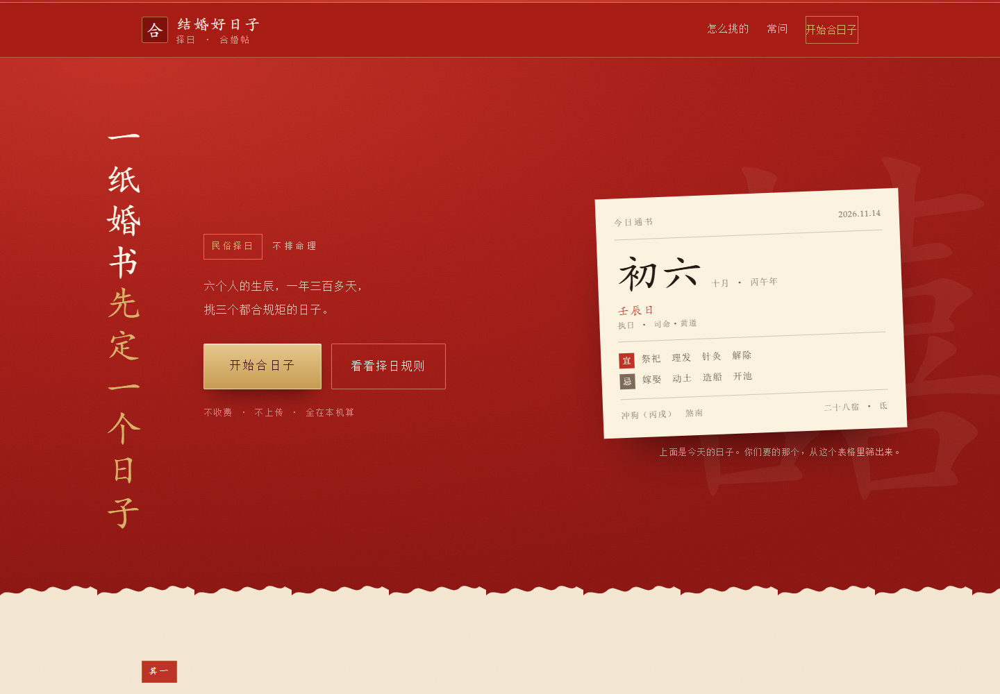
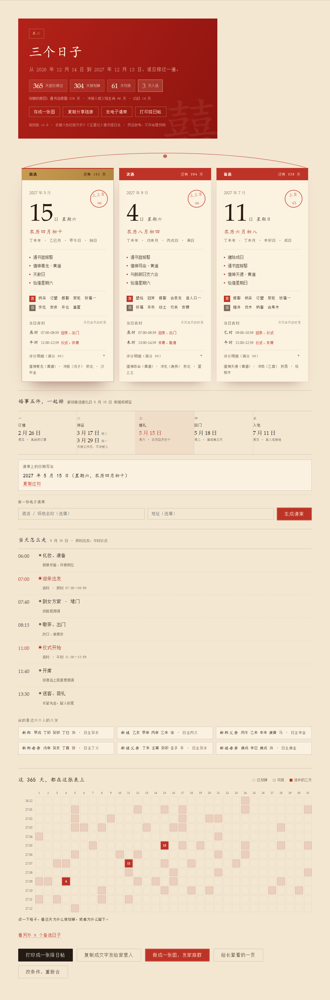

# 结婚好日子 · 择日

给新人用的「挑结婚日子」网页工具。填新郎、新娘（以及双方父母，选填）的生辰，
从未来半年到一年半里挑出三个都合规矩的日子，并写清楚为什么是它。

纯静态、无后端、无账号：双击 `结婚好日子/index.html` 就能用。



## 它做什么

- **合八字**：六人四柱、生肖、日主五行
- **筛日子**：通书忌嫁娶、月破、四离四绝、杨公忌、三娘煞、冲新人生肖与日支、冲父母生肖
- **排先后**：黄道值神、建除十二神、天德月德、天赦、三合六合、天喜红鸾、二十八宿
- **出三个**：首选 / 次选 / 备选，带评分、四条理由、两个吉时、宜忌
- **五件事**：订婚、领证、婚礼、回门、入宅，一次排完
- **当天流程**：按吉时排出迎亲 7 步时间表
- **能带走**：A4 择日帖（两页）、1080×1440 分享海报（带二维码）、电子请柬、给长辈看的一页
- **能回传**：输入编码进 `#q=` 链接，家里人打开即还原并直接出结果



## 快速开始

```bash
# 方式一：直接双击
结婚好日子/index.html

# 方式二：本地起个静态服务
cd 结婚好日子 && python -m http.server 8788
# 打开 http://127.0.0.1:8788/
```

部署到任意静态托管（对象存储 / GitHub Pages / Vercel）即可，不需要服务器和数据库。

## 目录

```
结婚好日子/
├─ index.html            主页面
├─ invite.html           电子请柬（独立页，数据走 URL hash）
├─ assets/
│  ├─ styles.css         全部样式（含移动端与两页打印版式）
│  ├─ engine.js          择日引擎：八字、神煞、冲煞、评分、吉时、五件事
│  ├─ app.js             交互：表单、渲染、海报、请柬、分享链接
│  └─ vendor/
│     ├─ lunar.js        历法内核 lunar-javascript（MIT，6tail）
│     └─ qrcode.js       二维码生成（MIT，Kazuhiko Arase）
└─ tests/engine.test.js  引擎回归测试（157 条断言）
docs/
├─ 自测报告.md
└─ screens/              界面与打印稿样张
```

## 测试

```bash
node 结婚好日子/tests/engine.test.js
```

157 条断言覆盖六人 / 仅新人 / 半年 / 一年半 / 闰月 / 避开七月 / 冲父母 / 不变量；
历法另有独立校验：604 个随机日期农历与 `zhdate` 一致，500 个日期日柱与儒略日公式一致。

产品链路（分享链接、海报二维码、打印页数、五档宽度）见 [自测报告](docs/自测报告.md)。

## 说明

择日依据《协纪辨方书》《玉匣记》一类通书的规则，是传统民俗，不是命理预测。
页面里没有命理推算，也不上传任何数据——所有计算都在浏览器本地完成。
